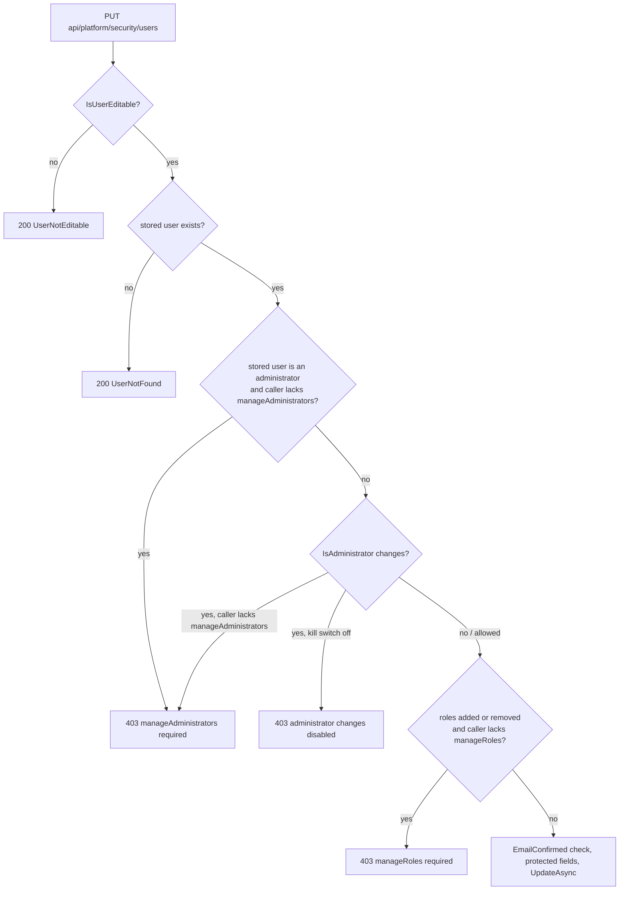

# User and role management — authorization rules

## Status

**Implemented.** Applies to the security API of the platform, `api/platform/security/*` (`SecurityController`).

## Context

A user gets rights in two ways:

| Source | How it becomes rights |
| --- | --- |
| `ApplicationUser.IsAdministrator` | `CustomUserClaimsPrincipalFactory` adds the system `Administrator` role claim, and `HasGlobalPermission` treats that role as holding **every** permission. |
| Roles | Each role's permissions are role claims copied into the user's principal. |

The most powerful operations of the security API — changing the administrator flag, managing administrator accounts, managing roles and role membership — were covered by the same `platform:security:create` / `platform:security:update` permissions as ordinary profile edits. This change gives them their own permissions and puts the administrator flag behind a setting, so each can be granted separately.

## Design

Sensitive operations get their own permission, following the existing pattern of `platform:security:verifyEmail` (needed to change `EmailConfirmed` in `PUT users`). The administrator flag also gets an AppSettings kill switch, following `Authorization:AllowUpdateProtectedUserFields`.

| Operation | Needs |
| --- | --- |
| Create an administrator, grant or revoke the administrator flag | `Authorization:AllowAdministratorChangesViaApi = true` **and** `platform:security:manageAdministrators` |
| Manage an administrator account: update it, change or reset its password, lock, unlock or delete it | `platform:security:manageAdministrators` |
| Create or edit roles and their permissions (`PUT roles`) | `platform:security:manageRoles` |
| Assign roles to a user or remove them (`POST users/create`, `PUT users`) | `platform:security:manageRoles` |
| Everything else in the security API | the existing permissions, unchanged |

The new permissions:

| Permission | Meaning |
| --- | --- |
| `platform:security:manageAdministrators` | Manage administrator accounts and, with the kill switch on, the administrator flag. |
| `platform:security:manageRoles` | Manage roles and role membership. Its holder can give any permission to any user, themselves included. |

Both are equivalent to administrator rights and are meant to be granted consciously. Administrators hold them automatically, because the `Administrator` role holds every permission. They are not granted to any role on upgrade.

The kill switch:

```json
"Authorization": {
  // While false, no one (administrators included) can create an administrator
  // or grant or revoke the flag through the API. Turn it on for the change, then off again.
  "AllowAdministratorChangesViaApi": false
}
```

As an environment variable: `Authorization__AllowAdministratorChangesViaApi=true`.

### Order of checks in `PUT users`



Roles count as changed when the user manager would add or remove one: the requested role names are compared with the stored ones the way `CustomUserManager.UpdateUserRolesAsync` compares them. A request whose `roles` is `null` doesn't touch roles.

## Endpoint matrix

| Endpoint | Endpoint permission | Additional check |
| --- | --- | --- |
| `POST users/create` | `security:create` | administrator flag → kill switch + `manageAdministrators`; roles → `manageRoles` |
| `PUT users` | `security:update` | administrator target → `manageAdministrators`; flag change → kill switch + `manageAdministrators`; role change → `manageRoles` |
| `POST users/{userName}/changepassword` | `security:update` | administrator target → `manageAdministrators` |
| `POST users/{userName}/resetpassword` | `security:update` | administrator target → `manageAdministrators` |
| `POST users/{id}/lock`, `users/{id}/unlock` | `security:update` | administrator target → `manageAdministrators` |
| `DELETE users` | `security:delete` | any administrator in the list → `manageAdministrators`; otherwise no one is deleted |
| `PUT roles` | **`security:manageRoles`** (was `security:update`) | — |

## Response contract

A refused request returns **403** with a `SecurityResult` whose `errors[0]` names the reason:

| Reason | `errors[0]` |
| --- | --- |
| Kill switch off | `Changing the administrator flag through the API is disabled. Set Authorization:AllowAdministratorChangesViaApi to true to allow it.` |
| No `manageAdministrators` | `Managing administrators requires the platform:security:manageAdministrators permission.` |
| No `manageRoles` | `Managing roles requires the platform:security:manageRoles permission.` |

`PUT users` with an id that does not exist now returns `200` with `UserNotFound` (it used to fail with a null reference, 500).

## What changed

| File | Change |
| --- | --- |
| `src/VirtoCommerce.Platform.Core/PlatformConstants.cs` | `SecurityManageAdministrators`, `SecurityManageRoles`, added to `AllPermissions`, so they are registered and get authorization policies. |
| `src/VirtoCommerce.Platform.Core/Security/AuthorizationOptions.cs` | `AllowAdministratorChangesViaApi`, default `false`. |
| `src/VirtoCommerce.Platform.Web/appsettings.json` | The kill switch, documented, set to `false`. |
| `src/VirtoCommerce.Platform.Web/Controllers/Api/SecurityController.cs` | Checks in the endpoints of the matrix; `PUT roles` authorized by `manageRoles`; `DELETE users` resolves all users before deleting any. New private region *Administrators and roles*: `CanManageAdministrators`, `CanManageRoles`, `CanManageUser`, `GetAdministratorFlagChangeRefusal`, `RolesChangeAsync`, `Forbidden`. All checks use `User.HasGlobalPermission`. |
| `tests/VirtoCommerce.Platform.Web.Tests/Controllers/Api/SecurityControllerTests.cs` | 27 new tests. Existing tests unchanged. |

### Compatibility

- No public signature, constructor or DI change; no database migration.
- **Administrators:** unchanged, except that creating an administrator or changing the flag needs the kill switch on. The *Is administrator* checkbox in the admin UIs returns the kill-switch error while it is off.
- **Non-administrators** with `security:update` / `security:create` keep managing profiles, passwords and locks of non-administrators. They now need `manageRoles` to change role membership or edit roles, and `manageAdministrators` to manage administrator accounts. Grant these deliberately after upgrade if such users exist.
- **Integrations** that create users with roles, or administrators, through a non-administrator account need the same permissions (and the kill switch for administrators).

### Follow-up outside this repository

- Admin UIs (`vc-module-admin-angular-js`, `vc-module-admin-shell`): display names for the two permissions in the localization files, and hiding the *Is administrator* checkbox and role editing from users who can't use them.

## Not covered

- The checks live at the API layer. Code that calls `UserManager`/`RoleManager` directly (modules, import jobs) is trusted as before.
- API key endpoints, `DELETE roles` and the e-mail verification/confirmation endpoints are unchanged.
- `UserType` changes (for example Customer → Manager) are not treated as a privilege grant.
- The upgrade doesn't change existing administrator accounts or role memberships.

## Verification

- `SecurityControllerTests`: 80/80 pass. With only the controller reverted to `dev`, the 17 tests for refusals and for the unknown user fail, and the tests for allowed operations pass.
- `VirtoCommerce.Platform.Web.Tests` 327/327, `VirtoCommerce.Platform.Core.Tests` 223/223, `VirtoCommerce.Platform.Tests` 958 passed (2 skipped); the solution builds.
