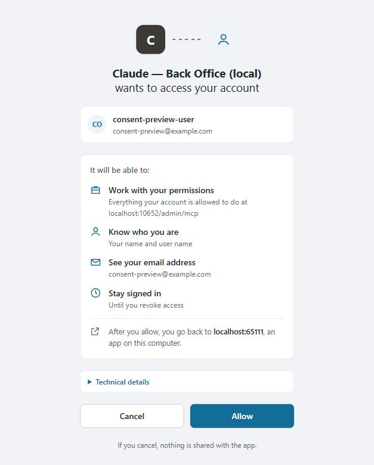

# OAuth sign-in and consent for interactive clients

An interactive client, such as an AI agent connecting to an MCP endpoint or a mobile app, gets a token for a user with
the authorization code flow and PKCE. The user signs in, sees what the client asks for on the platform's consent
page, and allows it; the client then exchanges the code for the token.

```
client ──► /connect/authorize ──► sign-in page ──► consent page ──► client's redirect URI ?code=…&iss=…
                                                                      │
client ◄── access token (and refresh token) ◄── /connect/token ◄──────┘  code + PKCE verifier
```

This article covers where the user signs in, what the consent page shows, how a front-end hosts the sign-in page,
and how to extend the choice of the sign-in page. Registering the client itself is done in
**Security → OAuth applications**.

## Where the user signs in

The platform chooses the sign-in page by the host the authorization request arrives on.

| The host has | The platform | `/connect/session` |
| --- | --- | --- |
| No login path (the default) | Redirects to the built-in login page, the back office's sign-in, which signs the user in with a cookie and returns to the authorization request | Not served (`404`) |
| A login path, such as `/oauth/authorize` | Redirects to that path on the same host, with `returnUrl` set to the authorization request. The front-end's page signs the user in and creates a session through `/connect/session` | Served |

The path is a relative redirect, so it must exist on the host of the request. A platform that serves several
front-ends — storefronts on their own hosts and the back office on the platform host — sets the path per host:

```json
"Authorization": {
  "OAuthLoginPath": "/oauth/authorize",
  "OAuthLoginPaths": {
    "admin.example.com": ""
  }
}
```

* `OAuthLoginPath` is the path for every host that `OAuthLoginPaths` does not list. Without it, every host uses the
  built-in login page.
* `OAuthLoginPaths` maps a host to its path. An empty path selects the built-in login page. Hosts are matched
  ignoring case and without the port.

As environment variables:

```
Authorization__OAuthLoginPath=/oauth/authorize
Authorization__OAuthLoginPaths__admin.example.com=
```

!!! note
    A platform that sets `OAuthLoginPath` for its storefront and also lets agents sign in to the back office, for
    example to the `/admin/mcp` endpoint of the MCP module, must list the platform host in `OAuthLoginPaths`.
    Otherwise the platform sends the back-office user to `https://<platform host>/oauth/authorize`, a page that only
    the storefront has, and the user sees a 404.

### Choose the sign-in page in code

`IOAuthLoginPathProvider` (`VirtoCommerce.Platform.Security.OpenIddict`) chooses the path; the default,
`OAuthLoginPathProvider`, reads the two settings. Replace it to take the hosts from data instead, such as the stores'
URLs:

```csharp
public class StoreLoginPathProvider(IOptions<AuthorizationOptions> options, IStoreSearchService storeSearchService)
    : OAuthLoginPathProvider(options)
{
    public override async Task<string> GetLoginPathAsync(string host)
    {
        // A store's host uses the storefront's sign-in page; any other host falls back to the configuration.
        // Cache the hosts in a real implementation: this runs on every authorization request.
        var stores = await storeSearchService.SearchAllNoCloneAsync(new StoreSearchCriteria());
        var isStoreHost = stores.Any(x => Uri.TryCreate(x.Url, UriKind.Absolute, out var url) && url.Host.EqualsIgnoreCase(host));

        return isStoreHost ? "/oauth/authorize" : await base.GetLoginPathAsync(host);
    }
}
```

```csharp
// Module.Initialize. The platform registers its provider with TryAdd, so this registration replaces it.
serviceCollection.AddSingleton<IOAuthLoginPathProvider, StoreLoginPathProvider>();
```

Return `null` for the built-in login page.

## Host the sign-in page in a front-end

A front-end page at the login path, such as the storefront's `/oauth/authorize`, receives `returnUrl`, signs the user
in with its usual sign-in, and hands the session to the platform:

| # | Request | Answer |
| --- | --- | --- |
| 1 | `GET /connect/session` with the user's access token as `Authorization: Bearer` | `{ "requestToken": "…" }`, an antiforgery token bound to the user |
| 2 | `POST /connect/session?returnUrl=<returnUrl>` with the same `Authorization` header, `RequestVerificationToken: <requestToken>`, and `Origin` equal to the page's own origin | `204`: a session for exactly that authorization request |
| 3 | Navigate the browser to `returnUrl` | The consent page, or the client's redirect URI with the code when the user consented before |

The rules the platform checks:

* The token is the user's own token, for the platform (`resource_server`), not a client's token and not an
  impersonation. The user can sign in: not locked out, and their password not expired.
* `Origin` is the scheme and host of the request. A request without it, or from another origin, answers `400`.
* `returnUrl` is a local `/connect/authorize?…` URL without a fragment.
* The session lasts 5 minutes, or until the user's token expires if that is sooner, and is valid only for that
  `returnUrl`. Pass `returnUrl` exactly as received: the platform compares it as a string with the authorization
  request, whose query values are percent-encoded (`%20` for a space, not `+`). A differently encoded URL sends the
  user back to the sign-in page.

## The consent page

Whether the platform asks depends on the client's consent type in **OAuth applications**:

| Consent type | The consent page |
| --- | --- |
| *Explicit* | Shown when the user has not allowed this client before, or when the client asks again with `prompt=consent` |
| *Systematic* | Shown every time |
| *Implicit* | Never shown: the code is issued at once |
| *External* | Never shown: the code is issued only when an administrator allowed the client for the user |



The page shows:

* **Who asks**: the client's display name from **OAuth applications**, with its first letter as the icon.
* **For which account**: the user name and email of the signed-in user.
* **What the client will be able to do**, in plain words:

    | The request has | The page says |
    | --- | --- |
    | A `resource`, such as an MCP endpoint | *Work with your permissions* — everything your account is allowed to do at `host/path` |
    | `openid` or `profile` | *Know who you are* — your user ID, or your name and user name with `profile` |
    | `email` | *See your email address*, with the address |
    | `roles` | *See your roles* |
    | `offline_access` | *Stay signed in* — until you revoke access |
    | Any other scope | The scope's display name and description from the OpenIddict scope store, or *Use "scope"* without them |

* **Where the user goes after Allow**: *an app on this computer* for a loopback redirect URI (`localhost`, `127.0.0.1`,
  `[::1]`), this site, or another site. For another site the page asks the user to allow only if they started the
  sign-in from that site, so a client that is not what it claims stands out.
* **Technical details**, collapsed: the client ID, the resources, the redirect URI and the scopes.

*Allow* issues the code; *Cancel* answers the client with `access_denied`, and nothing is shared. The page follows the
browser's light or dark theme, and on a narrow screen it stacks the buttons with *Allow* on top.

### When the form expires

The form carries an antiforgery token. If the page was open too long, or the browser replaced its cookie, the token is
refused. The platform then returns the browser to the same authorization request and shows the page again with a fresh
token and the notice *This page expired, so nothing was allowed yet*, instead of an empty `400`. It logs a Warning,
`The OAuth consent form was submitted with an invalid antiforgery token, so it is shown again`. The reason is in the
line ASP.NET Core logs just before it at Information level, such as
`Antiforgery token validation failed. The antiforgery token could not be decrypted.`

### Framing

The consent page can't be shown in a frame on any site: it is sent with `X-Frame-Options: DENY` and
`Content-Security-Policy: frame-ancestors 'none'`, whatever the `SecurityHeaders` settings allow for the rest of the
platform. Another site therefore can't overlay the page to trick the user into a click.

## Troubleshooting

| Symptom | Cause | Fix |
| --- | --- | --- |
| A 404 at `https://<platform host>/oauth/authorize?returnUrl=/connect/authorize…` | `OAuthLoginPath` is set, and the platform host is not listed in `OAuthLoginPaths` | List the platform host with an empty path |
| The token request fails with `invalid_target` | The `resource` is not in `Authorization:Resources`, or the client has no permission for it | Add the resource to the setting and tick it for the client in **OAuth applications** |
| `POST /connect/session` answers `400` with an empty body | No `Origin`, another origin, a `returnUrl` that is not `/connect/authorize`, or an antiforgery token taken without the user's token | Send the headers of step 2; take the request token with the `Authorization` header |
| `POST /connect/session` answers `404` | The host uses the built-in login page | The front-end's sign-in page is not used on this host; see *Where the user signs in* |
| After the session, the browser lands on the sign-in page again | `returnUrl` was re-encoded, or the 5-minute session expired | Pass `returnUrl` as received; create the session right before navigating |
| *This page expired* on the consent page | The form was open too long, or the cookie was replaced | Choose again; the Warning and the antiforgery log tell the reason |
