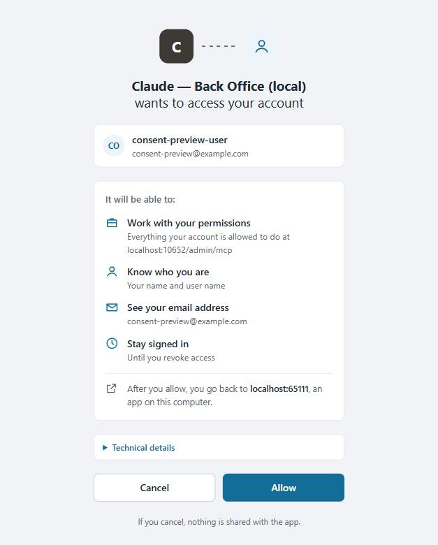

# OAuth sign-in and consent for interactive clients

An interactive client, such as an AI agent connecting to an MCP endpoint or a mobile app, gets a token for a user with
the authorization code flow and PKCE. The user signs in, sees what the client asks for on the platform's consent
page, and allows it; the client then exchanges the code for the token.

```
client ──► /connect/authorize ──► sign-in page ──► consent page ──► client's redirect URI ?code=…&iss=…
                                                                      │
client ◄── access token (and refresh token) ◄── /connect/token ◄──────┘  code + PKCE verifier
```

This article covers where the user signs in, what the consent page shows, how a front-end hosts the sign-in page,
and how to extend the choice of the sign-in page. An administrator registers a client in
**Security → OAuth applications**, or the client registers itself: see
[Clients that register themselves](#clients-that-register-themselves).

## Where the user signs in

The platform chooses the sign-in page by the host the authorization request arrives on.

| The host has | The platform | `/connect/session` |
| --- | --- | --- |
| No login path (the default) | Redirects to the built-in login page, the back office's sign-in, which signs the user in with a cookie and returns to the authorization request | Not served (`404`) |
| A login path, such as `/oauth/authorize` | Redirects to that path on the same host, with `returnUrl` set to the authorization request. The front-end's page signs the user in and creates a session through `/connect/session` | Served |

The path is a relative redirect, so it must exist on the host of the request. A platform that serves several
front-ends — storefronts on their own hosts and the back office on the platform host — sets the path per host:

```json
"Authorization": {
  "OAuthLoginPath": "/oauth/authorize",
  "OAuthLoginPaths": [
    { "Host": "admin.example.com" },
    { "Host": "vendors.example.com", "Path": "/vendor/sign-in" }
  ]
}
```

* `OAuthLoginPath` is the path for every host that `OAuthLoginPaths` does not list. Without it, every host uses the
  built-in login page.
* `OAuthLoginPaths` lists the hosts that use another page: their own `Path`, or the built-in login page when the
  entry has no `Path`. Hosts are matched ignoring case and without the port; the first entry of a host wins.

As environment variables, one index per host:

```
Authorization__OAuthLoginPath=/oauth/authorize
Authorization__OAuthLoginPaths__0__Host=admin.example.com
Authorization__OAuthLoginPaths__1__Host=vendors.example.com
Authorization__OAuthLoginPaths__1__Path=/vendor/sign-in
```

The host is a value, not a part of the variable's name, because some hosting environments, Virto Cloud among them,
drop variables whose names contain dots.

!!! note
    A platform that sets `OAuthLoginPath` for its storefront and also lets agents sign in to the back office, for
    example to the `/admin/mcp` endpoint of the MCP module, must list the platform host in `OAuthLoginPaths` without
    a path. Otherwise the platform sends the back-office user to `https://<platform host>/oauth/authorize`, a page
    that only the storefront has, and the user sees a 404.

### Choose the sign-in page in code

`IOAuthLoginPathProvider` (`VirtoCommerce.Platform.Security.OpenIddict`) chooses the path; the default,
`OAuthLoginPathProvider`, reads the two settings. Replace it to take the hosts from data instead, such as the stores'
URLs:

```csharp
public class StoreLoginPathProvider(IOptions<AuthorizationOptions> options, IStoreSearchService storeSearchService)
    : OAuthLoginPathProvider(options)
{
    public override async Task<string> GetLoginPathAsync(string host)
    {
        // A store's host uses the storefront's sign-in page; any other host falls back to the configuration.
        // Cache the hosts in a real implementation: this runs on every authorization request.
        var stores = await storeSearchService.SearchAllNoCloneAsync(new StoreSearchCriteria());
        var isStoreHost = stores.Any(x => Uri.TryCreate(x.Url, UriKind.Absolute, out var url) && url.Host.EqualsIgnoreCase(host));

        return isStoreHost ? "/oauth/authorize" : await base.GetLoginPathAsync(host);
    }
}
```

```csharp
// Module.Initialize. The platform registers its provider with TryAdd, so this registration replaces it.
serviceCollection.AddSingleton<IOAuthLoginPathProvider, StoreLoginPathProvider>();
```

Return `null` for the built-in login page.

## Host the sign-in page in a front-end

A front-end page at the login path, such as the storefront's `/oauth/authorize`, receives `returnUrl`, signs the user
in with its usual sign-in, and hands the session to the platform:

| # | Request | Answer |
| --- | --- | --- |
| 1 | `GET /connect/session` with the user's access token as `Authorization: Bearer` | `{ "requestToken": "…" }`, an antiforgery token bound to the user |
| 2 | `POST /connect/session?returnUrl=<returnUrl>` with the same `Authorization` header, `RequestVerificationToken: <requestToken>`, and `Origin` equal to the page's own origin | `204`: a session for exactly that authorization request |
| 3 | Navigate the browser to `returnUrl` | The consent page, or the client's redirect URI with the code when the user consented before |

The rules the platform checks:

* The token is the user's own token, for the platform (`resource_server`), not a client's token and not an
  impersonation. The user can sign in: not locked out, and their password not expired.
* `Origin` is the scheme and host of the request. A request without it, or from another origin, answers `400`.
* `returnUrl` is a local `/connect/authorize?…` URL without a fragment.
* The session lasts 5 minutes, or until the user's token expires if that is sooner, and is valid only for that
  `returnUrl`. Pass `returnUrl` exactly as received: the platform compares it as a string with the authorization
  request, whose query values are percent-encoded (`%20` for a space, not `+`). A differently encoded URL sends the
  user back to the sign-in page.

## The consent page

Whether the platform asks depends on the client's consent type in **OAuth applications**:

| Consent type | The consent page |
| --- | --- |
| *Explicit* | Shown when the user has not allowed this client before, or when the client asks again with `prompt=consent` |
| *Systematic* | Shown every time |
| *Implicit* | Never shown: the code is issued at once |
| *External* | Never shown: the code is issued only when an administrator allowed the client for the user |



The page shows:

* **Who asks**: the client's display name from **OAuth applications**, with its first letter as the icon. For a client
  that registered itself, a notice says so and names the site of its metadata document, such as *claude.ai*. When such
  a client returns to an app on this computer, the notice is a warning instead: any app on the computer can give the
  client id of a known app, so the user allows only if they started the sign-in themselves, just now.
* **For which account**: the user name and email of the signed-in user.
* **What the client will be able to do**, in plain words:

    | The request has | The page says |
    | --- | --- |
    | A `resource`, such as an MCP endpoint | *Work with your permissions* — everything your account is allowed to do at `host/path` |
    | `openid` or `profile` | *Know who you are* — your user ID, or your name and user name with `profile` |
    | `email` | *See your email address*, with the address |
    | `roles` | *See your roles* |
    | `offline_access` | *Stay signed in* — until you revoke access |
    | Any other scope | The scope's display name and description from the OpenIddict scope store, or *Use "scope"* without them |

* **Where the user goes after Allow**: *an app on this computer* for a loopback redirect URI (`localhost`, `127.0.0.1`,
  `[::1]`), this site, or another site. For another site the page asks the user to allow only if they started the
  sign-in from that site, so a client that is not what it claims stands out.
* **Technical details**, collapsed: the client ID, the resources, the redirect URI and the scopes.

*Allow* issues the code; *Cancel* answers the client with `access_denied`, and nothing is shared. The page follows the
browser's light or dark theme, and on a narrow screen it stacks the buttons with *Allow* on top.

### When the form expires

The form carries an antiforgery token. If the page was open too long, or the browser replaced its cookie, the token is
refused. The platform then returns the browser to the same authorization request and shows the page again with a fresh
token and the notice *This page expired, so nothing was allowed yet*, instead of an empty `400`. It logs a Warning,
`The OAuth consent form was submitted with an invalid antiforgery token, so it is shown again`. The reason is in the
line ASP.NET Core logs just before it at Information level, such as
`Antiforgery token validation failed. The antiforgery token could not be decrypted.`

### Framing

The consent page can't be shown in a frame on any site: it is sent with `X-Frame-Options: DENY` and
`Content-Security-Policy: frame-ancestors 'none'`, whatever the `SecurityHeaders` settings allow for the rest of the
platform. Another site therefore can't overlay the page to trick the user into a click.

## Clients that register themselves

An AI agent connects to an MCP endpoint with the endpoint's URL only, without a client an administrator registered
first, in one of two ways that the MCP authorization specification describes:

| Way | The client id | Setting |
| --- | --- | --- |
| Client ID metadata document | The HTTPS URL of a JSON document the client publishes, such as `https://claude.ai/oauth/claude-code-client-metadata` | On by default |
| Dynamic client registration (RFC 7591) | Issued by `POST /connect/register` | Off by default |

The authorization server metadata (`/.well-known/oauth-authorization-server`, `/.well-known/openid-configuration`)
tells clients which ways are on: `client_id_metadata_document_supported: true`, and `registration_endpoint`.

Either way, the client gets the least it needs, whatever it asks for:

* A public client: no secret, PKCE with `S256` required.
* The *Explicit* consent type: the user consents once per client and resource. Consent to `/admin/mcp` is not consent
  to `/vendor/mcp`; the client asks again for another resource. A client that returns to a loopback address, an app on
  the user's computer, gets the consent page at every sign-in, since any app on the computer can use its client id.
* The *Authorization code* and *Refresh token* grants and the `profile` scope; `openid` and `offline_access` are always
  allowed.
* The resources that allow self-registered clients: the module that serves a resource decides, with
  `OAuthResource.AllowSelfRegisteredClients` in its `IOAuthResourceProvider`, and documents how to configure it. An
  authorization request without `resource` is refused with `invalid_target`. The resource must also be in
  `Authorization:Resources`, as for any client.
* The token works only at the resource it names: the platform accepts it only on the path of that resource, for
  example `/admin/mcp`, and refuses it with `invalid_token` anywhere else, such as the REST API.

### Client ID metadata documents

At the authorization request, the platform fetches the document at the client id and checks that:

* The client id is an HTTPS URL of at most 100 characters with a path, without a fragment, user info, backslashes or
  dot segments.
* The document is a JSON object of at most `MaxDocumentSize` bytes, its `client_id` is the URL exactly, it lists
  `redirect_uris`, its `token_endpoint_auth_method` is `none`, it has no client secret, and its `grant_types` and
  `response_types`, when present, include `authorization_code` and `code`.
* The redirect URI of the request is one of the document's, compared exactly. A loopback redirect URI without a port,
  such as `http://localhost/callback`, accepts any port, as RFC 8252 describes for apps on the user's computer.

The platform fetches the document only from a public address: over HTTPS, without a proxy, not from a private,
loopback, link-local or other reserved address (the host's address is checked when the connection is made, so a host
that resolves to another address later can't be used to reach the platform's network), within `Timeout`. Only a `200`
answer counts: a redirect is not followed, so the document must be served at its client id itself. `AllowedHosts`
limits the sites further. To try a client on a developer's computer, `AllowLoopbackInDevelopment` lets the platform
fetch documents from `localhost` too, in the Development environment only; private network addresses stay refused.

A valid document is cached as its `Cache-Control` header says, between `MinCacheLifetime` and `MaxCacheLifetime`. An
error or an invalid document is not cached, so the next authorization request fetches it again. The client is stored
in **OAuth applications** when a user first consents to it, never before, and it follows its document when it is
fetched again: a new name applies at once, and new redirect URIs revoke every user's consent and the client's tokens,
so the users consent again to where the codes now go. A document that can't be fetched for a while, because of a
timeout or a server error, doesn't stop a stored client; a document that became invalid does.

**OAuth applications** in the back office marks such a client *Self-registered* and filters the list by how the
clients registered; the API takes `selfRegistered` in `POST /api/platform/oauthapps/search`, and the application's
`properties` carry `vc_registration`: `client_id_metadata_document` or `dynamic_registration`. An administrator can
open and delete such a client but not change it, since it follows its document or registration: saving it returns
400. Opening it shows the stored client without fetching its document, so it opens even when the document is gone or
the way it registered is turned off.

### Dynamic client registration

`POST /connect/register` with the client's metadata as JSON registers a public client and answers `201` with its
`client_id` and the metadata it got. Only `redirect_uris` (required) and `client_name` are taken from the request. A
request for a confidential client, or for grant or response types without the authorization code, answers `400` with
`invalid_client_metadata`; invalid redirect URIs answer `invalid_redirect_uri`.

Anyone can register a client, so turn this on only for agents that can't use a client ID metadata document. Turning
either way off stops the clients that registered that way too: they are refused until it is on again.

### Settings

```json
"Authorization": {
  "ClientRegistration": {
    "ClientIdMetadataDocuments": {
      "Enabled": true,
      "AllowedHosts": [],
      "MaxCacheLifetime": "01:00:00",
      "MinCacheLifetime": "00:05:00",
      "Timeout": "00:00:05",
      "MaxDocumentSize": 5120,
      "AllowLoopbackInDevelopment": false
    },
    "DynamicRegistration": {
      "Enabled": false
    }
  }
}
```

The values above are the defaults. `AllowedHosts` lists hosts such as `claude.ai`, or `*.example.com` for the
subdomains of `example.com`; empty allows any public host.

### Change the rules in code

The services below are registered with `TryAdd`, so a module that registers its own in `Initialize` replaces them.
Their methods are virtual, so a module can also derive from the platform's class and change one rule.

| Service | Decides |
| --- | --- |
| `IClientMetadataValidator` (`ClientMetadataValidator`) | Which metadata a self-registered client may give: the form of a client id URL, the authentication method, the grant and response types, the redirect URIs |
| `ISelfRegisteredClientFactory` (`SelfRegisteredClientFactory`) | The application a self-registered client gets: its type, permissions and requirements |
| `IClientIdMetadataDocumentResolver` (`ClientIdMetadataDocumentResolver`) | How a metadata document is fetched and cached |
| `IDynamicClientRegistrationService` (`DynamicClientRegistrationService`) | How a dynamic registration request becomes a client |

```csharp
// Registers only the clients that give their name
public class NamedClientsOnlyValidator(IOAuthAppRules appRules) : ClientMetadataValidator(appRules)
{
    public override ClientMetadataResult Validate(JsonElement metadata)
    {
        return GetString(metadata, ClientMetadata.Names.ClientName) == null
            ? ClientMetadataResult.Fail(ClientMetadata.Errors.InvalidClientMetadata, "The client_name is required.")
            : base.Validate(metadata);
    }
}

// Module.Initialize
serviceCollection.AddSingleton<IClientMetadataValidator, NamedClientsOnlyValidator>();
```

The check that a document is fetched only from a public address is not a service on purpose: replacing it would open
the platform's network to anyone who can send a client id.

### Revoke a client

A user's consent is stored as a permanent authorization; revoke it in the MCP module's *Connected agents*, or delete
the client in **OAuth applications** to revoke it for everyone. A client registered with a metadata document registers
again at its next authorization request, and the user is asked to consent again. To refuse such clients, turn the
documents off or list the allowed hosts. To block one client, delete it and register an application with the
same client id and no redirect URI in **OAuth applications**: an application an administrator registered takes
precedence over the document, and without a redirect URI it can't sign anyone in.

## Troubleshooting

| Symptom | Cause | Fix |
| --- | --- | --- |
| A 404 at `https://<platform host>/oauth/authorize?returnUrl=/connect/authorize…` | `OAuthLoginPath` is set, and the platform host is not listed in `OAuthLoginPaths` | List the platform host without a path |
| The token request fails with `invalid_target` | The `resource` is not in `Authorization:Resources`, or the client has no permission for it | Add the resource to the setting and tick it for the client in **OAuth applications** |
| `POST /connect/session` answers `400` with an empty body | No `Origin`, another origin, a `returnUrl` that is not `/connect/authorize`, or an antiforgery token taken without the user's token | Send the headers of step 2; take the request token with the `Authorization` header |
| `POST /connect/session` answers `404` | The host uses the built-in login page | The front-end's sign-in page is not used on this host; see *Where the user signs in* |
| After the session, the browser lands on the sign-in page again | `returnUrl` was re-encoded, or the 5-minute session expired | Pass `returnUrl` as received; create the session right before navigating |
| An agent that names a client id URL gets `invalid_request` with *The specified 'client_id' is invalid* | The metadata document can't be used | The platform logs why at Warning: `The client metadata document … can't be used: …` |
| A self-registered client gets `invalid_target` at the authorization request | The request has no `resource` | Connect with the URL of the resource, such as an MCP endpoint |
| A self-registered client gets `invalid_request`, *This client application is not allowed to use the specified resource(s)* | The resource doesn't allow self-registered clients | Use a resource whose module allows self-registered clients, or register a client for the agent in **OAuth applications** |
| *This page expired* on the consent page | The form was open too long, or the cookie was replaced | Choose again; the Warning and the antiforgery log tell the reason |
